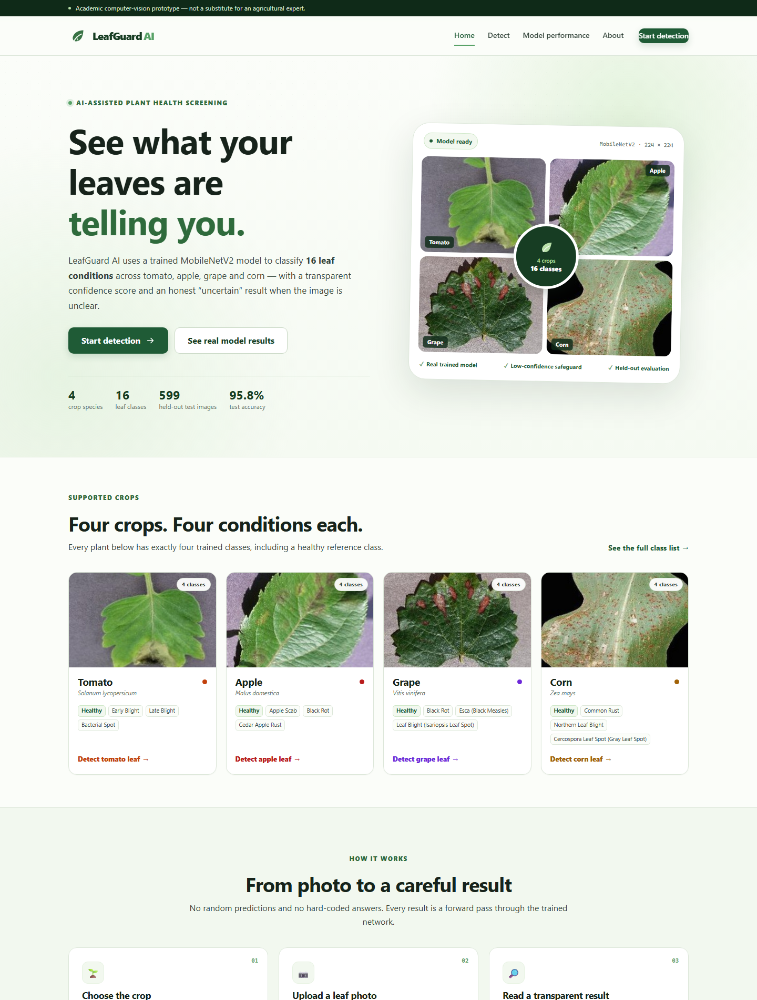
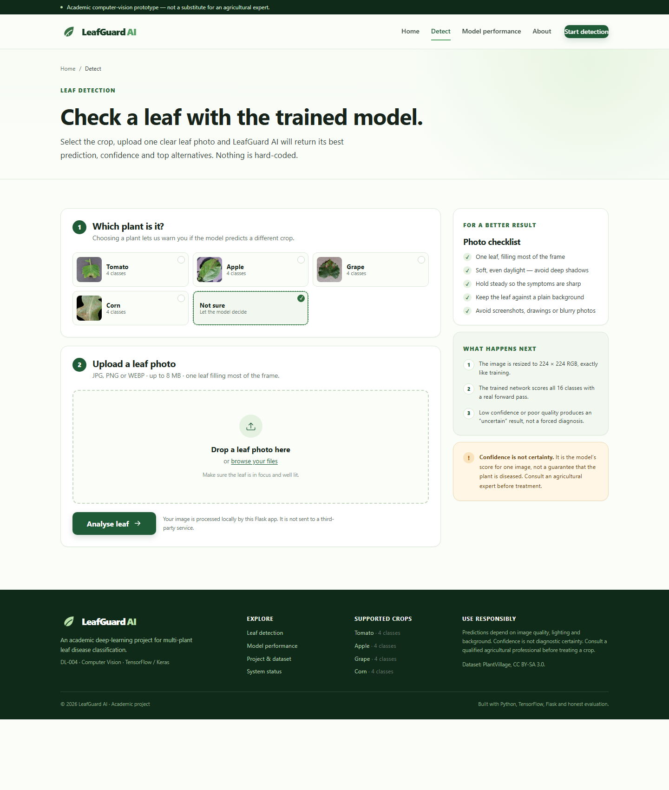
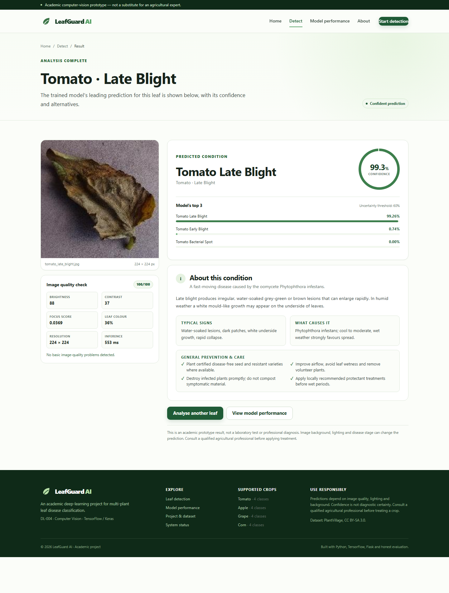
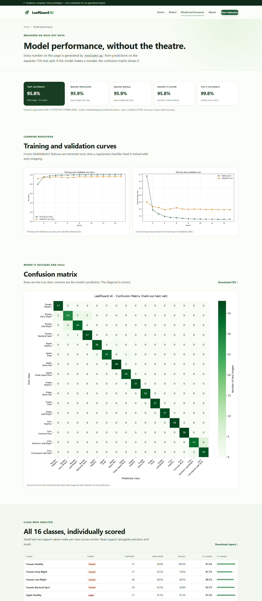
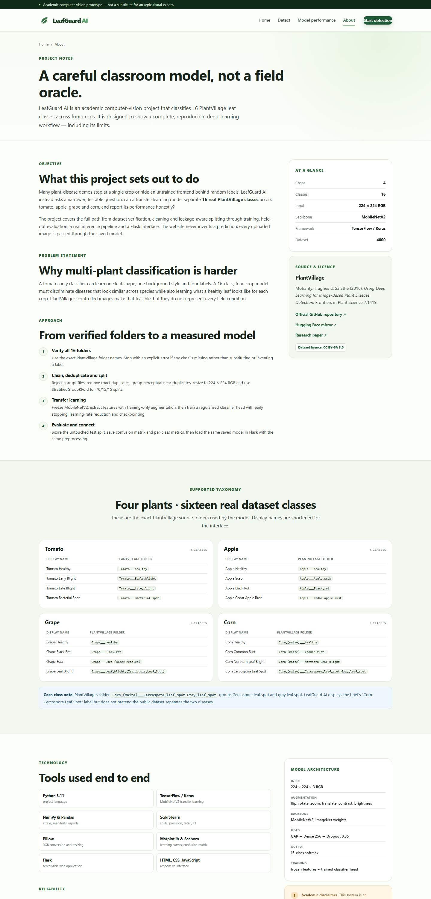
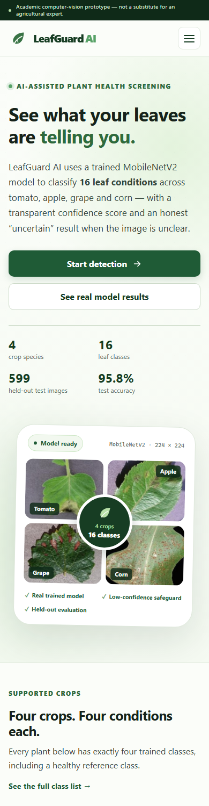

# LeafGuard AI

**Multi-Plant Leaf Disease Classification System**  
An academic Computer Vision project (DL-004) using TensorFlow/Keras, MobileNetV2 transfer learning and Flask.

[](https://www.python.org/)
[](https://tensorflow.org/)
[](https://flask.palletsprojects.com/)
[](https://github.com/spMohanty/PlantVillage-Dataset)
[](dataset/SOURCE.md)

> **Academic prototype.** LeafGuard AI is not a diagnostic device and is not a replacement for an agricultural expert. Confidence is a model score, not a guarantee.

---

## 1. Project overview

LeafGuard AI classifies **16 real PlantVillage leaf classes** across **four crops**: tomato, apple, grape and corn. Each crop has exactly four trained classes, including a healthy reference. A user selects a crop, uploads a leaf image and receives:

- the predicted plant and condition,
- the model's confidence and top-three alternatives,
- a basic image-quality report,
- an explicit **uncertain** result when confidence, margin or image quality is too low,
- general symptom and prevention information.

The project includes dataset preparation, cleaning and leakage-aware splitting, genuine model training, held-out evaluation, all evaluation artefacts, a reusable prediction pipeline, a Flask website and automated tests. No prediction, confidence value or metric is hard-coded.

## 2. Problem statement

Plant foliar diseases reduce yield and quality, and early identification helps target treatment. A tomato-only classifier cannot generalise across crops, and a frontend without a trained model cannot be trusted. The challenge is to build a **multi-plant, 16-class classifier** that:

1. uses a verified public dataset and real labels,
2. avoids train/test leakage,
3. is evaluated on data it has never seen,
4. communicates uncertainty honestly, and
5. is usable through a complete web interface.

## 3. Objectives

- Verify and document every dataset class before training.
- Build a reproducible 70/15/15 dataset pipeline with cleaning, RGB conversion, 224 × 224 resizing and stratified grouped splits.
- Train a genuine MobileNetV2 transfer-learning classifier for all 16 classes with training-only augmentation, EarlyStopping and ModelCheckpoint.
- Evaluate the saved model on the held-out test split and report accuracy, precision, recall, F1, confusion matrix and class-wise performance.
- Connect the **same saved model and preprocessing** to a professional Flask website.
- Detect low-confidence and poor-quality inputs and show an uncertain result rather than a misleading diagnosis.
- Test all four plants, invalid files and low-quality images end to end.

## 4. Supported plants and classes

| Plant | Class | PlantVillage source folder |
|---|---|---|
| Tomato | Tomato Healthy | `Tomato___healthy` |
| Tomato | Tomato Early Blight | `Tomato___Early_blight` |
| Tomato | Tomato Late Blight | `Tomato___Late_blight` |
| Tomato | Tomato Bacterial Spot | `Tomato___Bacterial_spot` |
| Apple | Apple Healthy | `Apple___healthy` |
| Apple | Apple Scab | `Apple___Apple_scab` |
| Apple | Apple Black Rot | `Apple___Black_rot` |
| Apple | Apple Cedar Apple Rust | `Apple___Cedar_apple_rust` |
| Grape | Grape Healthy | `Grape___healthy` |
| Grape | Grape Black Rot | `Grape___Black_rot` |
| Grape | Grape Esca | `Grape___Esca_(Black_Measles)` |
| Grape | Grape Leaf Blight | `Grape___Leaf_blight_(Isariopsis_Leaf_Spot)` |
| Corn | Corn Healthy | `Corn_(maize)___healthy` |
| Corn | Corn Common Rust | `Corn_(maize)___Common_rust_` |
| Corn | Corn Northern Leaf Blight | `Corn_(maize)___Northern_Leaf_Blight` |
| Corn | Corn Cercospora Leaf Spot | `Corn_(maize)___Cercospora_leaf_spot Gray_leaf_spot` |

**Corn naming note:** PlantVillage combines Cercospora leaf spot and gray leaf spot in one folder. The display name follows the brief, but the project documents the combined public label instead of pretending the two diseases were separated. See [dataset/SOURCE.md](dataset/SOURCE.md).

## 5. Dataset

| Item | Value |
|---|---|
| Dataset | PlantVillage colour images (unsegmented) |
| Official source | <https://github.com/spMohanty/PlantVillage-Dataset> |
| Mirror | <https://huggingface.co/datasets/mohanty/PlantVillage> |
| Paper | Mohanty, Hughes & Salathé (2016), *Frontiers in Plant Science* 7:1419 |
| Licence | **CC BY-SA 3.0** |
| Images used | **4,000** — 250 per class |
| Source image size | 256 × 256 JPEG |
| Working size | 224 × 224 RGB JPEG |
| Train / validation / test | **2,801 / 600 / 599** (70.03% / 15.00% / 14.97%) |

The download script samples deterministically with seed 42 and fails loudly if any class folder is missing or has fewer than 250 images. It does **not** substitute another class. Dataset provenance, attribution and the full folder list are in [dataset/SOURCE.md](dataset/SOURCE.md).

### Preprocessing and leakage protection

- Corrupt files are detected with Pillow and never used.
- Exact duplicates are removed using a SHA-256 hash of decoded RGB pixels.
- Perceptual dHash near-duplicates are grouped; the groups are kept in a single split.
- All images are converted to RGB and resized to 224 × 224 with Lanczos resampling.
- `StratifiedGroupKFold(n_splits=20)` produces the 70/15/15 split while preserving class proportions and duplicate groups.
- The test split is never used for training, early stopping or checkpoint selection.
- The prepared run found **0 corrupt files**, **0 exact duplicates**, and **3 near-duplicate groups** (6 images) that were kept together.

## 6. Model

```text
Input 224 × 224 × 3 RGB (0–255)
  → training augmentation (flip, rotation, zoom, translation, contrast, brightness)
  → Rescaling (1/127.5, offset −1)
  → MobileNetV2 backbone, ImageNet weights, frozen
  → GlobalAveragePooling2D (1,280 features)
  → BatchNormalization
  → Dense 256, ReLU, L2(1e-4)
  → Dropout 0.40
  → Dense 16, softmax
```

Training uses the real 4,000-image dataset:

- frozen-backbone transfer learning (feature extraction) for CPU practicality,
- one randomly augmented copy per training image (training split only),
- class weights,
- Adam, categorical cross-entropy,
- **EarlyStopping**, **ModelCheckpoint**, **ReduceLROnPlateau** and **TerminateOnNaN**,
- per-class and overall evaluation on the untouched test split.

The saved model is a single `.keras` file containing the backbone, head and rescaling layer. Inference always feeds raw 0–255 RGB pixels, so training and website preprocessing cannot silently diverge.

## 7. Actual model results


| Metric | Measured value |
|---|---:|
| Test accuracy | **95.83%** |
| Macro precision | **95.89%** |
| Macro recall | **95.87%** |
| Macro F1-score | **95.83%** |
| Top-3 accuracy | **99.83%** |
| Weighted F1-score | 95.79% |
| Test images | 599 (36–39 per class) |
| Mean confidence | 97.02% |

These values were generated by `evaluate.py` from the saved model's predictions on the untouched test split. Full per-class results:

| Class | Support | Precision | Recall | F1 |
|---|---:|---:|---:|---:|
| Tomato Healthy | 37 | 94.9% | 100.0% | 97.4% |
| Tomato Early Blight | 37 | 85.3% | 78.4% | 81.7% |
| Tomato Late Blight | 38 | 89.5% | 89.5% | 89.5% |
| Tomato Bacterial Spot | 39 | 92.5% | 94.9% | 93.7% |
| Apple Healthy | 37 | 97.3% | 97.3% | 97.3% |
| Apple Scab | 37 | 100.0% | 94.6% | 97.2% |
| Apple Black Rot | 38 | 97.4% | 100.0% | 98.7% |
| Apple Cedar Apple Rust | 36 | 97.3% | 100.0% | 98.6% |
| Grape Healthy | 37 | 100.0% | 100.0% | 100.0% |
| Grape Black Rot | 36 | 100.0% | 100.0% | 100.0% |
| Grape Esca | 37 | 100.0% | 100.0% | 100.0% |
| Grape Leaf Blight | 37 | 100.0% | 100.0% | 100.0% |
| Corn Healthy | 38 | 100.0% | 100.0% | 100.0% |
| Corn Common Rust | 38 | 100.0% | 100.0% | 100.0% |
| Corn Northern Leaf Blight | 39 | 94.3% | 84.6% | 89.2% |
| Corn Cercospora Leaf Spot | 38 | 85.7% | 94.7% | 90.0% |

The model's weakest classes are **Tomato Early Blight** (F1 81.7%) and **Corn Northern Leaf Blight** (F1 89.2%). The confusion matrix shows exactly which classes were confused. All figures are available in `results/model_metrics.json`, `results/classification_report.txt` and `results/confusion_matrix.png`.

**Read this carefully:** 95.83% test accuracy on controlled PlantVillage images does **not** mean 95.83% accuracy on a phone photo from a farm. See the limitations section.


See [results/README.md](results/README.md) for the full artefact list.

## 8. Website

| Page | What it does |
|---|---|
| **Home** | Project introduction, four plant cards, 16-class count, real model status and evaluation summary |
| **Detect** | Plant selection, drag-and-drop upload, preview and real model inference |
| **Results** | Uploaded image, predicted plant/disease, confidence, top-3 scores, quality report, uncertainty warning, description and prevention |
| **Model performance** | Real test accuracy, macro precision/recall/F1, learning curves, confusion matrix and class-wise table |
| **About** | Objective, technologies, dataset/licence, full 16-class taxonomy and limitations |

The interface is responsive, uses a green/white agricultural theme and avoids unnecessary animation.

### Prediction reliability

1. The uploaded file is checked for extension, size, real image content and minimum resolution.
2. Brightness, contrast, focus (Laplacian variance), colourfulness and coarse leaf-colour coverage are measured.
3. The saved model performs a real forward pass over all 16 classes.
4. The result is marked **uncertain** if top confidence is below **60%**, the top-two margin is below **15%**, or the image fails the quality check.
5. A plant mismatch is flagged if the selected crop differs from the model's predicted crop.
6. Confidence is described as a model score, not diagnostic certainty.

## Screenshots

| Home | Plant selection &amp; upload |
|---|---|
|  |  |

| Real prediction result | Model performance |
|---|---|
|  |  |

| About &amp; dataset notes | Mobile layout |
|---|---|
|  |  |

These are screenshots of the locally running application, captured after
training and evaluation. The result screenshot is a real prediction from a
held-out test image, not a mock-up.

## 9. Project structure

```text
LeafGuard-AI/
├── app.py                       Flask application
├── train.py                     feature-extraction transfer learning
├── evaluate.py                  held-out evaluation and plots
├── predict.py                   command-line prediction
├── dataset_prep.py              cleaning, 224 resize, dedup and split
├── requirements.txt
├── README.md
├── LICENSE
├── sitecustomize.py             optional local vendor path hook
├── dataset/                     downloaded and generated data (not committed)
│   ├── raw/
│   ├── processed_224/
│   ├── splits/
│   ├── dataset_summary.json
│   └── SOURCE.md
├── models/                      trained model and metadata
├── results/                     real metrics and figures
├── templates/                   Jinja/HTML pages
├── static/                      CSS, JS, images, uploads
├── docs/screenshots/             real application screenshots
├── scripts/
│   ├── download_dataset.py
│   └── build_manifest.py
├── utils/
│   ├── labels.py
│   ├── image_quality.py
│   ├── predictor.py
│   └── paths.py
└── tests/
```

## 10. Installation

Use **Python 3.11** (TensorFlow 2.16 does not support Python 3.14).

### Clone

```bash
git clone https://github.com/mauryadeepa7078-ux/Plant-Leaf-Disease-Classification-Deep-Learning-Project.git
cd Plant-Leaf-Disease-Classification-Deep-Learning-Project
```

### Windows PowerShell

```powershell
py -3.11 -m venv .venv
.\.venv\Scripts\Activate.ps1
python -m pip install --upgrade pip
pip install -r requirements.txt
```

### macOS / Linux

```bash
python3.11 -m venv .venv
source .venv/bin/activate
python -m pip install --upgrade pip
pip install -r requirements.txt
```

If PowerShell blocks activation, run `Set-ExecutionPolicy -Scope Process Bypass` for the current terminal only.

## 11. Reproduce the pipeline

Run from the project root.

```powershell
# 1. Download the deterministic 250-images-per-class subset
python scripts/download_dataset.py

# 2. Inspect, clean, resize and split the data
python dataset_prep.py

# 3. Train the model (CPU-friendly feature-extraction transfer learning)
python train.py

# 4. Evaluate on the held-out test split
python evaluate.py
```

`train.py` caches frozen features in `models/feature_cache_*.npz`. If the
dataset changes, rebuild them:

```powershell
python train.py --rebuild-features
```

### Train output

- `models/leafguard_mobilenetv2.keras` — complete inference model
- `models/class_names.json`, `label_map.json`, `preprocessing.json`
- `models/model_metadata.json`
- `results/training_history.json`, `training_head_log.csv`, `model_summary.txt`

### Evaluate output

- `results/model_metrics.json`
- `results/classification_report.txt` and `.csv`
- `results/confusion_matrix.csv`, `confusion_matrix_normalized.csv`, `confusion_matrix.png`
- `results/accuracy_curve.png`, `loss_curve.png`, `class_f1_scores.png`
- `results/class_wise_performance.csv`, `test_predictions.csv`
- `results/sample_predictions.png`

## 12. Run the website

```powershell
python app.py
```

Open <http://127.0.0.1:5000>.

If port 5000 is already occupied by another local app, choose another port:

```powershell
$env:PORT=5050
python app.py
```

Then open <http://127.0.0.1:5050>. The app starts even if the model is missing,
but detection is disabled and the health endpoint reports `"model_ready":
false`. Train the model before a demo. For a production-style run, use a WSGI
server and change the Flask secret key.

### Command-line prediction

```powershell
python predict.py path\to\leaf.jpg --plant Tomato
python predict.py path\to\leaf.jpg --json
```

## 13. Tests

```powershell
pytest -q
```

Verified in this workspace: **22 passed** (including a live Flask test-client run
for one correct image from each of the four plants and a blank-image uncertainty
test).

The test suite checks:

- exactly 16 classes, four per plant, and the 16 expected PlantVillage folders,
- split sizes, class representation and absence of exact/group leakage,
- RGB 224 × 224 processed images,
- model input/output shape and softmax sums,
- evaluation support totals,
- all five website pages and the health endpoint,
- invalid file extension and corrupt image handling,
- real predictions for one correct test image from each of the four plants,
- an uncertain result for a blank low-quality upload.

## 14. Results and limitations

### Results

`evaluate.py` writes the measured values to `results/model_metrics.json` and
the website reads them directly. The README table above is updated from that
same file. Do not report numbers from a different run without re-evaluating.

### Limitations

- PlantVillage images are controlled, mostly plain-background photographs; real farm photos are harder.
- Background, lighting, blur, leaf age and camera quality can change predictions.
- Per-class test support is only 36–39 images, so class-level scores are noisy.
- Some diseases look alike, and the corn Cercospora/gray leaf spot class is combined in the public dataset.
- The model has not been field-validated across regions, cultivars, seasons or devices.
- Confidence is not diagnostic certainty; high confidence can still be wrong.
- The model is an educational prototype, not a replacement for an agricultural expert.
- Real deployment would require a field-collected, expert-labelled dataset, external validation and monitoring.

## 15. Dataset licence and attribution

PlantVillage images are licensed **CC BY-SA 3.0**. Retain attribution and share
adaptations under the same licence. The source code of LeafGuard AI is
separately licensed under the MIT Licence. See [LICENSE](LICENSE) and
[dataset/SOURCE.md](dataset/SOURCE.md).

## 16. What was verified

- All 16 promised PlantVillage folders exist and were downloaded from the authors' repository.
- Exactly 4 crops × 4 classes are present.
- The 4,000 images were decoded successfully; no corrupt files or exact duplicates were found.
- The split is 70/15/15 with no group or exact-hash leakage.
- The trained model has a 16-class softmax output and is reloaded from disk for evaluation.
- The Flask app uses the saved model and the same 224 × 224 RGB pipeline.
- All four crops, invalid uploads and a low-quality upload are covered by automated tests.

---

**Course:** Deep Learning / Computer Vision (DL-004)  
**Project:** LeafGuard AI — Multi-Plant Leaf Disease Classification System
